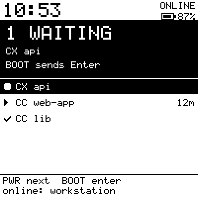
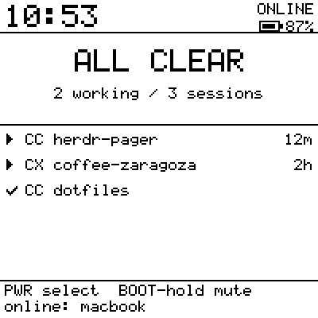
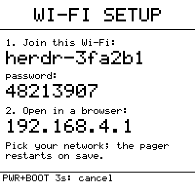
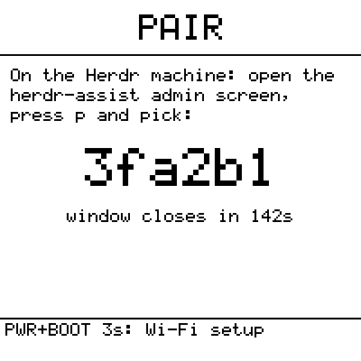

# herdr-assist para Waveshare ESP32-S3-ePaper-1.54

Um **pager** para o Herdr: uma tela de e-paper de 1,54" que mostra qual agente
está esperando por você, toca um sino quando um deles para para pedir uma
decisão e deixa responder com dois botões — sem abrir terminal nenhum.

É o mesmo herdr-assist do painel de 3,5": a mesma ponte, o mesmo protocolo, o
mesmo pareamento e o mesmo OTA. A ponte ganhou só o que o pager precisava: o
nome do agente vem do rótulo da aba e, opcionalmente (`BRIDGE_MACHINES`), os
agentes das máquinas SSH salvas entram no mesmo snapshot. O que muda é a cara: em
200×200 monocromático não cabe terminal, então o device faz uma coisa só, e faz
bem.

| Alguém esperando | Tudo em ordem | Configurar o Wi-Fi | Parear |
|:---:|:---:|:---:|:---:|
|  |  |  |  |
| A banda inverte; o sino toca na transição | Esperando primeiro, depois trabalhando | Celular entra na rede do pager | O host entrega a config |

> As imagens acima são renderizações do próprio `pager_ui.c` no host
> (`scripts/pager_ui_test.c`), pixel a pixel o que vai para o vidro.

> Este diretório é um projeto PlatformIO independente. O firmware do painel
> continua na raiz do repositório e não é afetado.

| | |
|---|---|
| Placa | Waveshare ESP32-S3-ePaper-1.54 — **V2** (ESP32-S3-PICO-1-N8R8, 8 MB flash, 8 MB PSRAM octal) ou **V1** (ESP32-S3FH4R2, 4 MB flash, 2 MB PSRAM quad) |
| Tela | 1,54" 200×200 preto e branco, controlador SSD1681 |
| Entrada | dois botões laterais: PWR e o segundo botão (na V2 serigrafado com um sol; no esquema e aqui ele é o **BOOT**) |
| Som | codec ES8311 + amplificador (o sino) |
| Relógio | RTC PCF85063 (a hora sobrevive ao desligar) |
| Bateria | LiPo 3,7 V no conector MX1.25 (vem junto no SKU sem `-EN`), carregada pela USB-C |
| Framework | ESP-IDF 5.2.1 (`espressif32@6.6.0`, o mesmo do painel) |

**Atenção ao modelo:** a mesma página da Waveshare vende uma versão **G** de
quatro cores, com refresh de 15–20 s — inútil como pager. Este firmware é para a
preto e branco. Para saber se a sua é V1 ou V2: a V2 tem `V2` na serigrafia e o
`esptool.py flash_id` mostra 8 MB.

## Gravando

**Faça o backup antes de qualquer gravação.** A placa vem com o firmware de
fábrica, e depois disso é a sua configuração que vive ali — e o `-install.bin`
apaga a NVS, então a cópia feita agora é a única que vai existir. Ligue a placa
na USB e leia a flash inteira:

```sh
esptool.py --chip esp32s3 --port /dev/ttyACM0 flash_id          # 4 MB = V1 · 8 MB = V2
esptool.py --chip esp32s3 --port /dev/ttyACM0 read_flash 0x0 0x800000 backup-fabrica-v2.bin
sha256sum backup-fabrica-v2.bin     # guarde o hash junto do arquivo (e o flash_id e o MAC)
```

Na V1 o tamanho é `0x400000` (4 MB). Restaurar é uma gravação só, no mesmo
endereço: `esptool.py --chip esp32s3 --port /dev/ttyACM0 write_flash 0x0
backup-fabrica-v2.bin`. Se o que você quer preservar é só o Wi-Fi e o
pareamento, salve apenas as regiões de dados — mas o tamanho depende da tabela
que está na placa: com o **firmware de fábrica** a NVS vai de `0x9000` por
`0x6000` e **não existe `otadata`** (é uma imagem só de fábrica, sem slots OTA);
no layout deste device a NVS é `0x9000`/`0x4000` e o `otadata` é
`0xd000`/`0x2000`. Confira com `esptool.py ... read_flash 0x8000 0x1000 -`
antes de decidir o que copiar.

> Use o esptool na série 4.x (`pipx install "esptool~=4.8"`), a mesma que o
> `release.yml` fixa.

Sem toolchain: baixe do [release mais recente](https://github.com/walcew/herdr-assist/releases/latest)
o binário da sua revisão e grave com esptool:

```sh
# V2
esptool.py --chip esp32s3 write_flash 0x0 herdr-assist-epaper154-VERSAO-install.bin
# V1
esptool.py --chip esp32s3 write_flash 0x0 herdr-assist-epaper154-v1-VERSAO-install.bin
```

Do código-fonte:

```sh
cd epaper154
pio run -e epaper154 -t upload        # V2   (epaper154-v1 para a V1)
pio device monitor
```

## Primeiro uso

1. **Wi-Fi.** Sem rede configurada, o pager abre uma rede própria
   (`herdr-xxxxxx`, WPA2) e mostra na tela o nome, a senha de 8 dígitos e o
   endereço `192.168.4.1`. Entre nela pelo celular, abra o endereço, escolha a
   rede da casa, a senha e o fuso horário, e salve: o pager reinicia já na sua
   rede. Nada é digitado no device.
2. **Pareamento.** Conectado e sem host, o pager abre sozinho a janela de
   pareamento (3 minutos) e mostra um código de 6 caracteres. No computador do
   Herdr, abra a tela de administração do herdr-assist, aperte `p` e escolha o
   código — exatamente como no painel (veja o [manual de pareamento](../docs/pairing.md)).
   O host entrega nome, endereço, porta e token; o pager grava e reinicia
   conectado.

Pronto: a tela passa a listar as sessões do Herdr.

> **Descoberta e firewall.** O pareamento grava o host **sem endereço fixo**: a
> cada reconexão o pager pergunta por broadcast (UDP, na porta da ponte) e adota o
> IP que a ponte assina com o token — então o DHCP do roteador pode trocar o
> endereço do computador sem quebrar nada. Em troca, a máquina da ponte precisa
> aceitar **TCP e UDP** nessa porta (9375 por padrão): TCP é a conexão do painel,
> UDP é a descoberta. No Windows com WSL o firewall comum não basta — o Hyper-V
> firewall bloqueia entrada por padrão e é outra regra:
>
> ```powershell
> New-NetFirewallHyperVRule -Name "herdr-assist" -Direction Inbound -Protocol TCP -LocalPorts 9375 -Action Allow
> New-NetFirewallHyperVRule -Name "herdr-assist-udp" -Direction Inbound -Protocol UDP -LocalPorts 9375 -Action Allow
> ```
>
> Sem a regra UDP a ponte sobe e escuta, mas o pager simplesmente não a encontra
> (fica `OFFLINE`); sem a TCP ele encontra e não conecta. Broadcast não cruza
> roteador: para um pager fora do mesmo segmento, pareie com um endereço fixo.

## Os dois botões

| Gesto | Na tela principal |
|---|---|
| **PWR** curto | anda uma sessão por vez — a lista já vem com quem espera no topo, depois o resto — e manda `focus` (a sessão aparece no Herdr) |
| **PWR** longo (0,7 s) | abre a janela de pareamento (novo host ou reparear) |
| **PWR** 3 s | desliga; o PWR acorda |
| **BOOT** curto | manda **Enter** para a sessão que está **esperando** (a que a banda nomeia: o foco se ele já for um bloqueado, senão a primeira da lista). Sem ninguém esperando não manda nada, para não injetar tecla no meio do trabalho de um agente ocupado |
| **BOOT** longo (0,7 s) | sino mudo / ligado (fica gravado) |
| **BOOT** 3 s | instala a atualização de firmware, quando o rodapé mostra `UPDATE` |
| **PWR + BOOT** 3 s | volta à configuração do Wi-Fi (de novo, cancela) |

O Enter vai para a sessão que está **na tela**, invertida na lista e com o nome
na banda de alerta: nunca se aprova às cegas. A allowlist de teclas continua
sendo aplicada na ponte.

## Como ele se comporta

- **O sino toca na transição, nunca no estado.** Dois tons quando um agente
  entra em `blocked`, três quando o número de esperando sobe. O boot e as
  reconexões são silenciosos: o primeiro payload depois de conectar vira a
  linha de base.
- **A tela só muda quando algo muda.** A UI redesenha no framebuffer e compara
  com o último quadro enviado; sem diferença, o e-paper fica quieto. O normal é
  o refresh rápido (sem o pisca); um refresh total limpa o ghosting a cada 30
  rápidos e em toda troca de tela.
- **A hora** vem do SNTP e é gravada no RTC; no próximo boot ela já está certa
  antes do Wi-Fi.
- **Bateria.** A carga aparece no topo (some quando não há célula) e o
  indicador inverte abaixo de 15 %. Entre um evento e outro o chip entra em
  light sleep sozinho, com o Wi-Fi em modem sleep — a conexão com a ponte
  continua de pé, então o sino chega na hora mesmo na bateria. O codec e o
  amplificador só ficam ligados enquanto o sino toca. Com um PC na USB o light
  sleep fica suspenso para o log funcionar; num carregador ele vale
  normalmente. Abaixo de 3,3 V o pager avisa no vidro e desliga.
- **OTA** igual ao do painel: checagem diária, mas cada revisão lê o seu
  manifest (`manifest-epaper154.json` / `manifest-epaper154-v1.json`) — nunca o
  `manifest.json` do painel.

## Estrutura

| Arquivo | Papel |
|---|---|
| `src/main.c` | Boot e a máquina de estados (Wi-Fi → pareamento → principal), botões, sino |
| `src/pager_ui.c` | A tela: faixas, fonte 5×7, foco por identidade do pane; C puro, testada no host |
| `src/epd_fb.c` | Framebuffer de 1 bit e primitivas; C puro |
| `src/epd_bsp.c` | O vidro: SSD1681 via `espressif/esp_lcd_ssd1681`, política rápido/total |
| `src/chime.c` | O sino: ES8311 via `espressif/esp_codec_dev`, tom sintetizado em runtime |
| `src/buttons.c`, `src/buttons_machine.c` | Varredura e a gramática curto/longo/3 s/acorde (esta, C puro) |
| `src/portal.c`, `src/portal_form.c` | Ponto de acesso + página de configuração do Wi-Fi |
| `src/rtc_clock.c` | PCF85063: RTC ↔ relógio do sistema |
| `src/board.c`, `src/board_pins.h` | Trilhas de energia, I2C compartilhado, todos os pinos (do `user_config.h` oficial) |
| `src/settings.c` | Fuso e mudo (NVS própria; o `panel_cfg` compartilhado não muda) |
| `src/battery.c`, `src/battery_level.c` | ADC da bateria (GPIO4, divisor 1:2, do exemplo oficial) e a curva de carga (esta, C puro) |
| `scripts/sync_shared.py` | Copia de `../src` os módulos compartilhados, carimba a versão e o manifest |
| `scripts/pager_ui_test.c` | Teste de host: tela, foco, botões, formulário e bateria; gera as imagens deste README |

Módulos compartilhados com o painel (copiados no build, nunca editados aqui):
`discovery`, `panel_cfg`, `herdr_model`, `limits_merge`, `activity_log`,
`herdr_conn`, `pairing`, `net`, `fw_update`. A mudança no `src/` do painel se
resume a dois guards que não alteram o comportamento dele: `MANIFEST_URL`
sobrescrevível (`fw_update.c`) e o fuso respeitado quando já definido (`net.c`).

## Teste de host

Sem placa, sem IDF:

```sh
cc -std=c11 -Wall -Wextra -Isrc -Iscripts/hoststub -Iepaper154/src -o /tmp/put \
   epaper154/scripts/pager_ui_test.c epaper154/src/pager_ui.c epaper154/src/epd_fb.c \
   epaper154/src/buttons_machine.c epaper154/src/portal_form.c epaper154/src/battery_level.c
/tmp/put /tmp/telas      # grava cada tela como PBM 200x200
```

Roda no CI junto com os outros testes de host.

## Dependências e licenças

Nada de terceiros vendorizado: o driver do painel (`espressif/esp_lcd_ssd1681`)
e o do codec (`espressif/esp_codec_dev`) vêm do registry da Espressif pelo
component manager, ambos Apache-2.0. As tabelas de waveform do painel
(`src/ssd1681_lut_1in54_v2.h`) foram copiadas do exemplo do próprio componente,
Unlicense/CC0. Pinos e trilhas de energia: `user_config.h` e `board_cfg.txt` dos
exemplos ESP-IDF oficiais da Waveshare (só os números, nenhum código).
